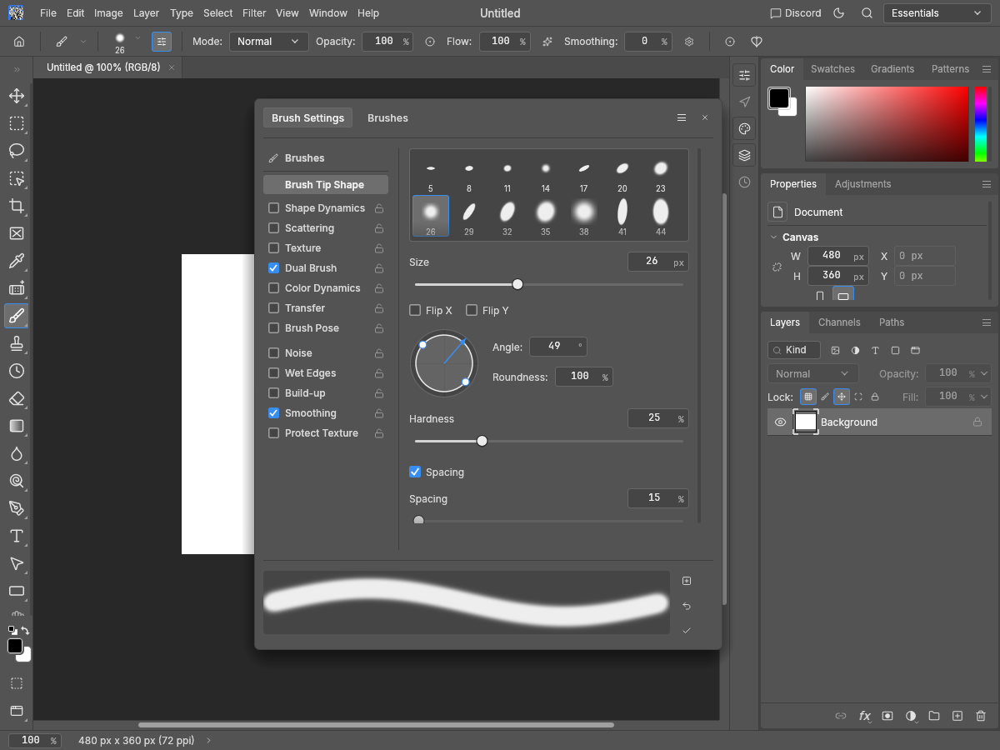
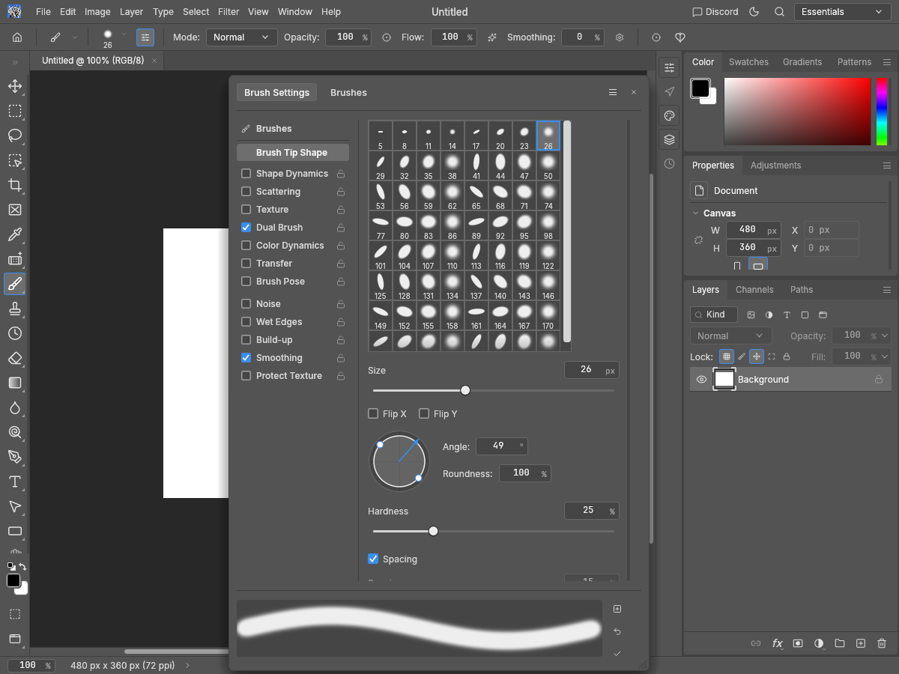
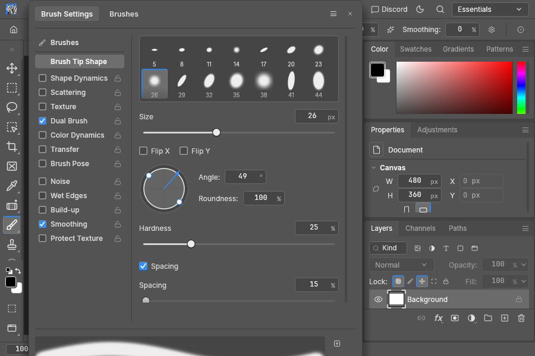
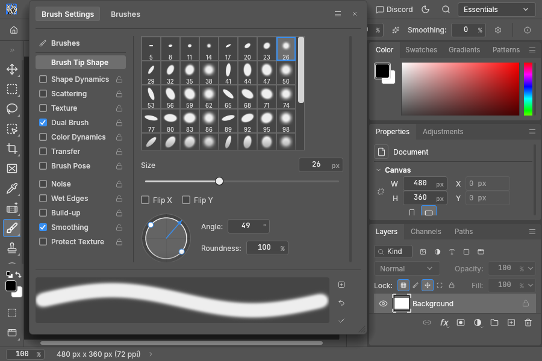

# Brush Settings tip-grid evidence

Addresses the Brush Tip Shape grid item and the shared Dual Brush grid item in [#3825](https://github.com/storytold/photocraft/issues/3825), plus a bounded, vertically resizable options viewport related to [#3477](https://github.com/storytold/photocraft/issues/3477). Both tracking issues remain open.

Baseline: clean main 99e1138877e6aa7e856c6883b415e708d042fc59. After: tested source 77d70a4d58f2f30ae10512eba564dcaf0f88bb7b. All 18 native Metal images inspected on Apple M4. No Photoshop installation, proprietary assets or pixel oracle was used; geometry follows the reporter's written observation.

The old grid wraps seven 44-point cells, has whitespace between entries, shows about two rows and hides its scrollbar. The new grid has eight 32×40 logical-point cells, one-point cell/outer borders, a two-point named selection and a permanently allocated scrollbar with a contrasting idle handle. Logical points scale with display density. The grid takes half the available options viewport, not a claim of exact half-window Photoshop pixel parity. The window can resize vertically; outer scrolling keeps lower controls reachable and the preview/actions remain visible at 900×600. The primary highlight retains its named preset identity; Dual Brush shares the geometry and scrolling while retaining its existing unselected-tip behavior.

Eight new regression/guard tests: seven fail at the baseline; the disabled-selection guard passes in both. Tests cover pointer positions in every column across 14 themes, actual idle thumb painting for empty/short/long lists, identity of look-alike tips, Space selection, bounded cached thumbnails while scrolling to tip 2,499, adjoining seams/selection strokes, the real window's minimal engine commands without losing dynamics/locks/flips, and resize/outer scrolling without brush/history changes.

Full UI package with HEIF, examples and doctests: 2,797 passed, zero failed, 12 ignored. Strict all-target Clippy, fmt, layers and wasm passed. No engine commands, formats or paint algorithms changed.

## Native fixtures

English; synthetic white 480×360 document. The included capture.py removes built-in presets through commands, creates 64 original computed tips (or 1/0 for short/empty), chooses named tip 7 and opens Brush Settings. Primary cases also have Dual Brush enabled, size 47; Dual-off disables it. Exact before/after command scripts and their SHA256 are identical.

Cases: Pro Medium and Light at 1200×900/1×, Pro Medium at 900×720/1× and 2×, 900×600/1×, empty/one-tip libraries, and Dual Brush enabled/disabled. Snapshot scripts start at the top; the regression test scrolls the outer options area to verify lower Spacing controls. Initial visual review caught an invisible solid scrollbar thumb despite its accessible node; final tests and screenshots verify contrast at rest.

## Local release UI measurement

6000×4000 document, 1200×900 window, 12 warm-up + 60 measured frames per case. Same original fixtures, CPU and release overrides (LTO=false, codegen-units=16) in both revisions; project profiles unchanged. Measures Brush Settings egui CPU work with cached thumbnails through egui_kittest Harness.run_steps(1), including harness/accessibility overhead and excluding canvas composition and GPU presentation. It is not a full 24 MP painting/frame benchmark. The expanded viewport shows more thumbnails, so the rendered work is deliberately not pixel-identical. Idle frames must preserve brush/history and thumbnail render counts.

| Presets | Before median / p95 ms | After median / p95 ms | Cached previews |
| --- | --- | --- | --- |
| 64 | 0.115 / 0.129 | 0.152 / 0.165 | 22 → 65 |
| 2,048 | 0.462 / 0.488 | 0.126 / 0.131 | 22 → 65 |
| 8,192 | 1.690 / 1.943 | 0.116 / 0.118 | 22 → 65 |

Measurements ran before the source commit; the unmodified quick report therefore records the baseline Git HEAD with dirty=true. The production-file SHA256 values in visual-summary.json match the final source commit. Single local run per revision; these timings are evidence, not a cross-platform guarantee. Quick perf_scenarios emitted 34 rows without benchmark errors. Its machine-class baseline comparison was skipped, and quick mode does not enforce full-size budgets; see the raw report.

## Reproduce

Use a separate source checkout at the exact before/after revision. Build the snapshot example with HEIF. Run capture.py --phase before/after --repo /path/to/source --out /path/to/captures. Its baseline guard permits only the test-only module additions. For the UI measurement, copy grid_evidence_perf.rs to crates/ui-egui/examples/ and run with the same release environment overrides and --locked --release -p photocraft-ui-egui --features photocraft-io/heif --example grid_evidence_perf. Remove that temporary example after measuring.

Validation commands:

    cargo test --locked -p photocraft-ui-egui --features photocraft-io/heif --no-fail-fast
    cargo clippy --locked -p photocraft-ui-egui --features photocraft-io/heif --all-targets -- -D warnings
    cargo fmt --all -- --check
    cargo xtask layers
    cargo xtask wasm
    CARGO_PROFILE_RELEASE_LTO=false CARGO_PROFILE_RELEASE_CODEGEN_UNITS=16 cargo xtask perf --quick --bench perf_scenarios

Original scripts and synthetic fixtures: MIT OR Apache-2.0 (license files included). Screenshots depict PhotoCraft's UI/branding and a synthetic blank document; no Photoshop assets were copied.

| Before | After |
| --- | --- |
|  |  |
|  |  |
