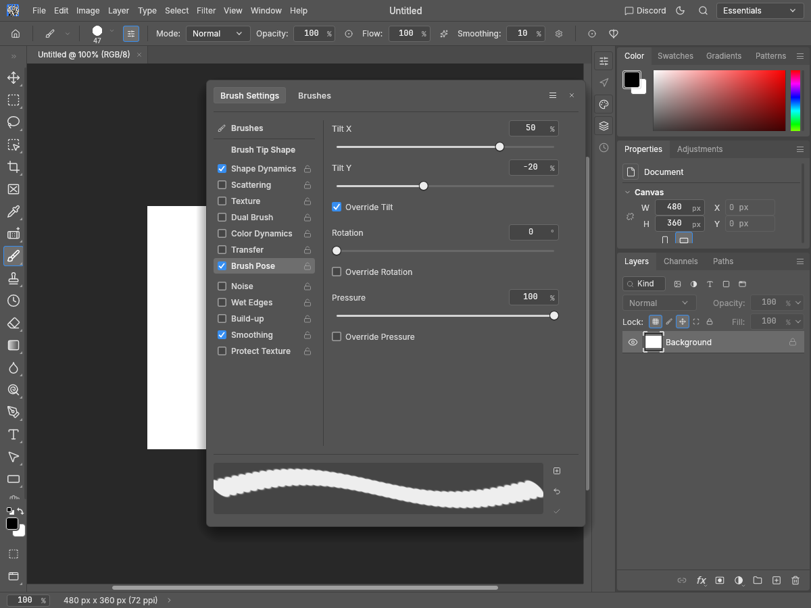
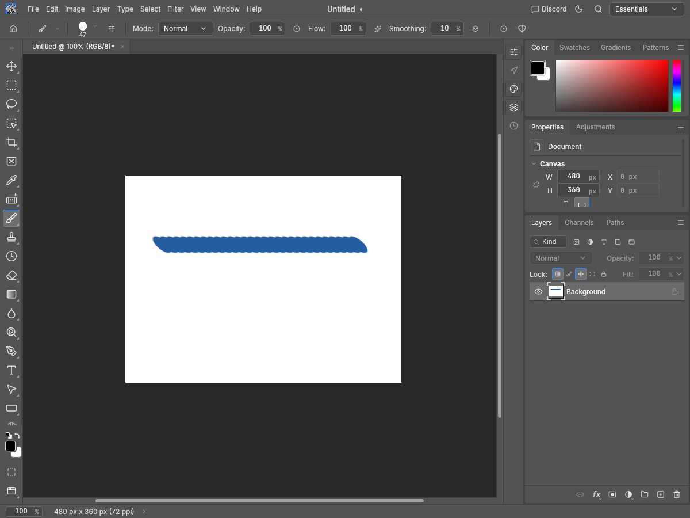

# Brush Pose axis evidence

Addresses the missing Override Tilt X/Y controls in the Brush Pose subsection of [#3825](https://github.com/storytold/photocraft/issues/3825), together with the underlying import/painting bug. This does not close the whole assessment.

Before: native snapshot built from clean main `99e1138877e6aa7e856c6883b415e708d042fc59`. After: tested source `811a40bda2db6b3d7b70665517a68beb300df8dd`. All 20 images inspected on Apple M4 / Metal. No physical tablet or Photoshop pixel oracle was used for this change.

Four ABR v6.1 fixtures are generated from scratch with PhotoCraft's descriptor/ABR writer: no overrides, X only, Y only, both. They contain a computed 47 px tip, −23° angle, 47% roundness, enabled Brush Pose and Brush Projection, X=50% (45°), Y=−20% (−18°). The fixture files are byte-identical across phases; SHA256 manifests are included. No Photoshop files, code or assets were used.

The baseline combines the imported flags with OR and replaces both live tilt components. X-only and Y-only baseline panel images and painted images are byte-identical. Afterward, each checkbox and stroke reflects only its selected axis. Paint traces use the same points: (64,120,pressure .71,tilt 13°/−27°) to (416,120,pressure .83,tilt −31°/42°), colour #245ca0, seed 19, white 480×360 document. UI images use English, Pro Medium/Light at 1200×900/1× and Pro Medium at 900×720/2×. Canvas comparison ROI is [218, 305, 698, 665]; after X-only/Y-only canvas differences: 3,793 pixels.

Eight new regression/guard tests: seven fail on the baseline; the legacy combined/rotation/pressure guard passes before and after. Coverage spans all four flag combinations, ABR v6.1/v6.2 import, JSON/preset persistence, command patches/replay, malformed flags with atomic failure, actual dabs and RGBA8/16/32F pixels, 14 themes, keyboard Space and the real settings window. Shared checkbox metadata exposes a named CheckBox without changing existing mouse-to-Enter behavior; the existing shared-widget keyboard test was extended. Full touched-package suite, examples and doctests: 5,235 passed, zero failed, 36 ignored. All required gates below passed. The full corpus suite and quick smoke benchmark use temporary LTO-off/codegen-16 release builds to avoid repeating expensive link optimisation for its many test binaries; the project profile is unchanged. The 24 MP benchmark uses the default release profile in both revisions.

Disabled Pose: 17.235 → 17.413 ms median; Enabled legacy two-axis Pose: 15.878 → 15.889 ms median. One warm-up plus five measured runs per case; identical 508-dab counts and stroke-centre sample checksums. These timings are local evidence, not a cross-platform performance guarantee.

The quick smoke benchmark emitted 34 rows without benchmark errors. Its regression comparison was skipped because the stored baseline is a different machine class; quick-mode full-size budgets do not apply. See the unmodified quick report for those limits.

```sh
cargo test --locked -p photocraft-paint -p photocraft-io -p photocraft-engine -p photocraft-ui-egui --features photocraft-io/heif --no-fail-fast
cargo clippy --locked -p photocraft-paint -p photocraft-io -p photocraft-engine -p photocraft-ui-egui --features photocraft-io/heif --all-targets -- -D warnings
cargo fmt --all -- --check
cargo xtask layers
cargo xtask wasm
cargo test --locked -p photocraft-engine --features photocraft-io/heif --test panic_hunt -- --ignored
CARGO_PROFILE_RELEASE_LTO=false CARGO_PROFILE_RELEASE_CODEGEN_UNITS=16 cargo xtask test-corpus
CARGO_PROFILE_RELEASE_LTO=false CARGO_PROFILE_RELEASE_CODEGEN_UNITS=16 cargo xtask perf --quick --bench perf_scenarios
```

## Reproduce screenshots

Keep this evidence checkout separate from the source checkout. Copy `pose_evidence_fixture.rs` into the source's `crates/io/examples/`, then run:

```sh
cargo run --locked -p photocraft-io --example pose_evidence_fixture -- /path/to/evidence/3825-pose-fixtures
cargo build --locked -p photocraft-ui-egui --features photocraft-io/heif --example snapshot
python3 /path/to/evidence/capture.py --repo /path/to/source --out /path/to/captures --phase after
```

For before images, build the exact baseline and pass `--phase before`. The included fixture bytes avoid needing to regenerate them. The generator is temporary evidence tooling, outside the code PR.

For the benchmark, copy `pose_evidence_perf.rs` into the source's `crates/paint/examples/` and run `cargo run --locked --release -p photocraft-paint --example pose_evidence_perf` at each exact revision. It materializes a 6000×4000 RGBA8 surface and renders 512 points in 16-point chunks. Both phases use the legacy combined input, preserving the effective workload; the checksum samples stroke-centre pixels rather than the whole image. The new pixel regressions separately compare exact output over their painted bounds at three depths.

Original evidence scripts and synthetic fixture bytes are offered under MIT OR Apache-2.0; the matching project license files are included. Screenshots show PhotoCraft's UI and a synthetic blank document.

| Before | After |
| --- | --- |
|  |  |
|  |  |
