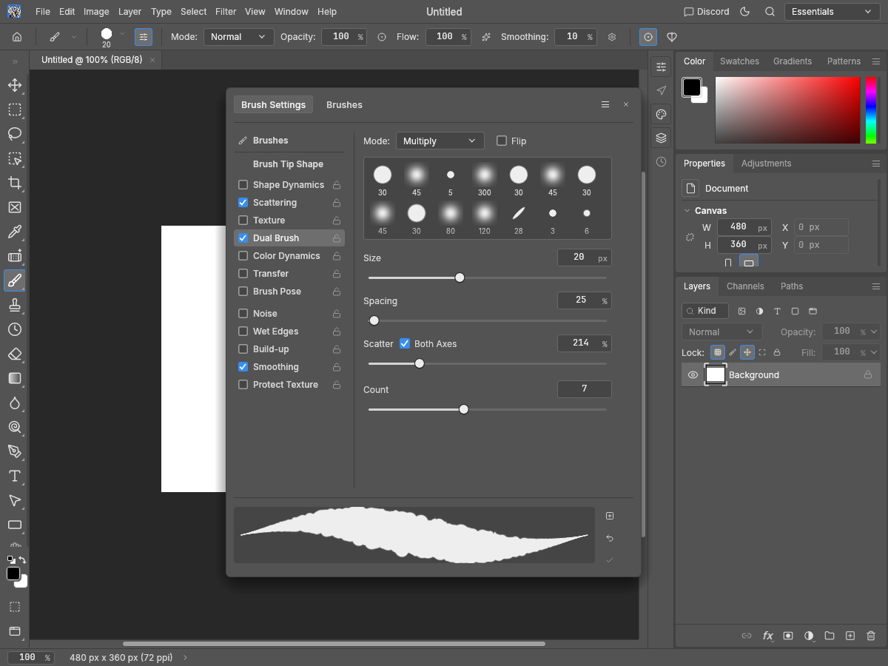

# Scatter / Both Axes header evidence

Addresses only the Both Axes placement subsection in Scattering and Dual Brush of https://github.com/storytold/photocraft/issues/3825.

Before source: clean main `99e1138877e6aa7e856c6883b415e708d042fc59`. After source: `fe083602a4fcff30159257c89af699f561bbaef3`. All twelve images were generated with the native egui snapshot example (Apple M4 / Metal) and inspected. Synthetic white 480×360 document, English UI. Both sections enabled, Both Axes checked, scatter `2.137` shown as 214%. Primary Count 5, Dual Brush Count 7. Pro Medium and Pro Light at 1200×900, plus Pro Medium at 900×720 with 2× display scale. Identical fixture for before/after.

| Section | Before | After |
| --- | --- | --- |
| Scattering |  |  |
| Dual Brush |  |  |

Capture names identify phase, theme/scale and section. Images and reproduction script are kept on a separate fork branch, outside the code PR.

## Verification

Four new egui regression tests. The two layout tests fail before the fix, one for each section, because the checkbox is below the Scatter header. Both pass afterward across all 14 themes and both axis-flag values. Two behavioral guards pass before and after: fractional-value retention on toggles, percentage input and 0..1000% limits, label scrubbing across the intervening checkbox, amount-track drags, exact `tools.setBrush` routing to the correct brush block and disabled-section input rejection.

Full UI package with HEIF, including examples and doctests: 2,793 passed, zero failed, 12 ignored. Strict UI all-target Clippy, fmt, layers and wasm passed.

```sh
cargo test --locked -p photocraft-ui-egui --features photocraft-io/heif --no-fail-fast
cargo clippy --locked -p photocraft-ui-egui --features photocraft-io/heif --all-targets -- -D warnings
cargo fmt --all -- --check
cargo xtask layers
cargo xtask wasm
cargo build --locked -p photocraft-ui-egui --features photocraft-io/heif --example snapshot
python3 capture.py --repo /path/to/photocraft --out /path/to/captures --phase after
```

For before captures, build the exact before revision and use `--phase before`.
