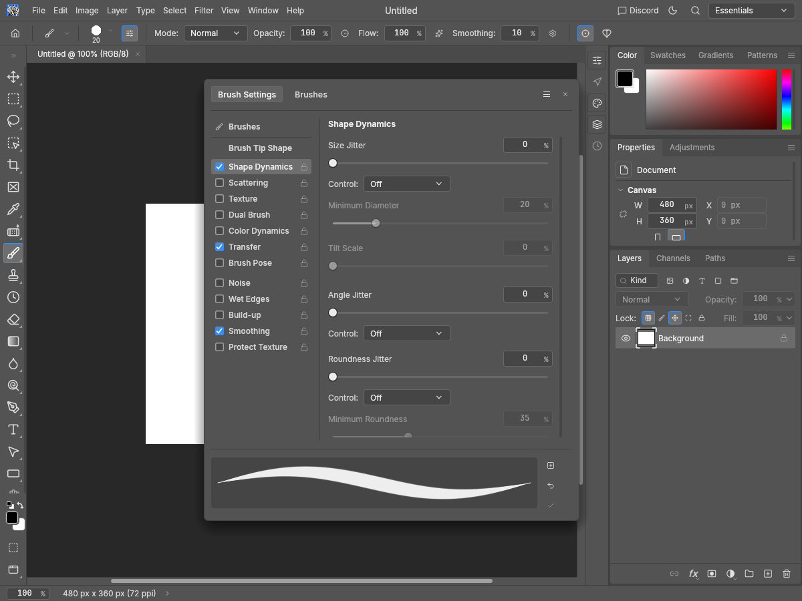

# Brush Settings Fade fields: refreshed merge evidence

PR: https://github.com/storytold/photocraft/pull/4829

After source: `f9edab830426093ee1c54da335444bf8ed91ee50`, merging main `995bc89c40433532db503714f0732cdbb1ac4c1c` into original Fade head `a26251e8bc6838e21f1d5b57aa357377faf8b3e2`.
The merge keeps the original Fade UI implementation and its three regressions unchanged, and retains the landed Hue Jitter implementation/tests and both documentation progress notes. The code PR still changes only four files.

The five refreshed after images were generated from this merged source with the native egui snapshot example (Apple M4 / Metal). Synthetic 480×360 document, English UI; no personal artwork. Pro Medium and Pro Light at 1200×900, plus 900×720 at 2× scale. The active Fade count is 123.

`before.png` is the original pre-Fade capture at `18ae8dc4`, whose `brush_sections.rs` matches the original test baseline `04f0b0e8`. It already includes the minimum-input fix; it is historical before evidence, not a new capture of the current main. Original all-14-theme/two-size review provenance: https://github.com/augrclk/photocraft/blob/3d672bce74f89f426a71e8a62616fad4b1fe4f44/README.md

| Historical before | Refreshed Control Off |
| --- | --- |
|  |  |

[Active Fade](4829-refresh-active.png) · [Transfer](4829-refresh-transfer.png) · [Light](4829-refresh-light.png) · [2× scale](4829-refresh-scale2.png)

## Local verification on the merged source

UI library and integration tests with HEIF: 2,788 passed, zero failed, 12 ignored across 27 test binaries. Strict UI all-target Clippy, fmt, layer checks, wasm checks and native snapshot build passed. The originally disclosed channel-cache pointer assertion did not recur in this refresh; its earlier cause remains unestablished.

```sh
cargo test --locked -p photocraft-ui-egui --features photocraft-io/heif --lib --tests --no-fail-fast
cargo clippy --locked -p photocraft-ui-egui --features photocraft-io/heif --all-targets -- -D warnings
cargo fmt --all -- --check
cargo xtask layers
cargo xtask wasm
cargo build --locked -p photocraft-ui-egui --features photocraft-io/heif --example snapshot
python3 capture.py --repo /path/to/photocraft --out /path/to/captures
```

Use the tested source revision above for reproduction. `capture.py` contains the exact five brush/UI fixtures. The evidence lives on an independent fork branch; no image files are added to the code PR.
