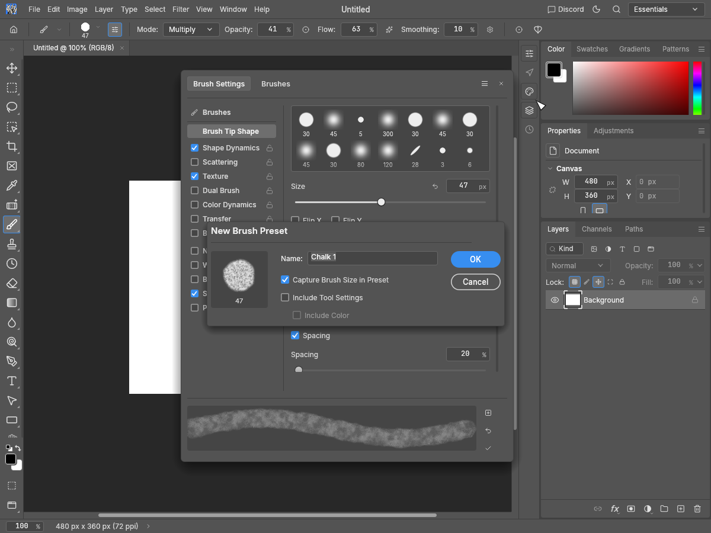
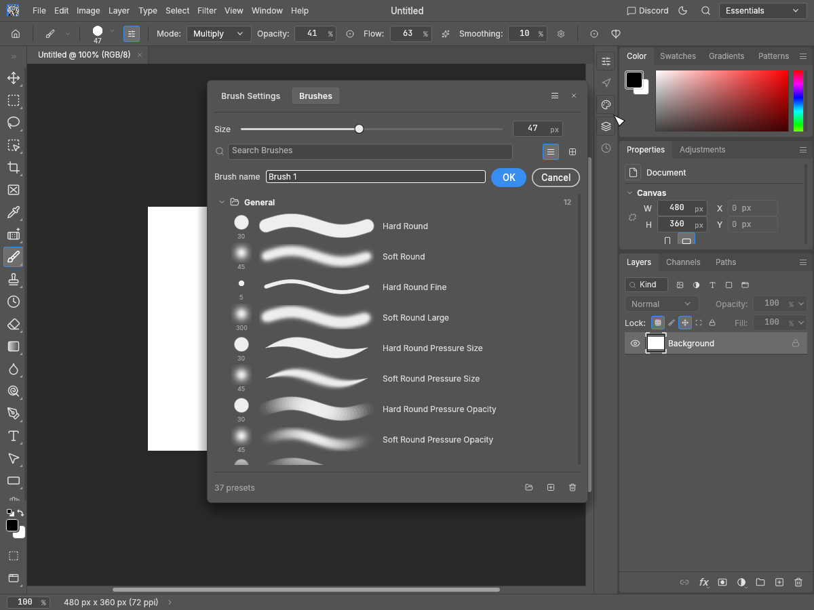
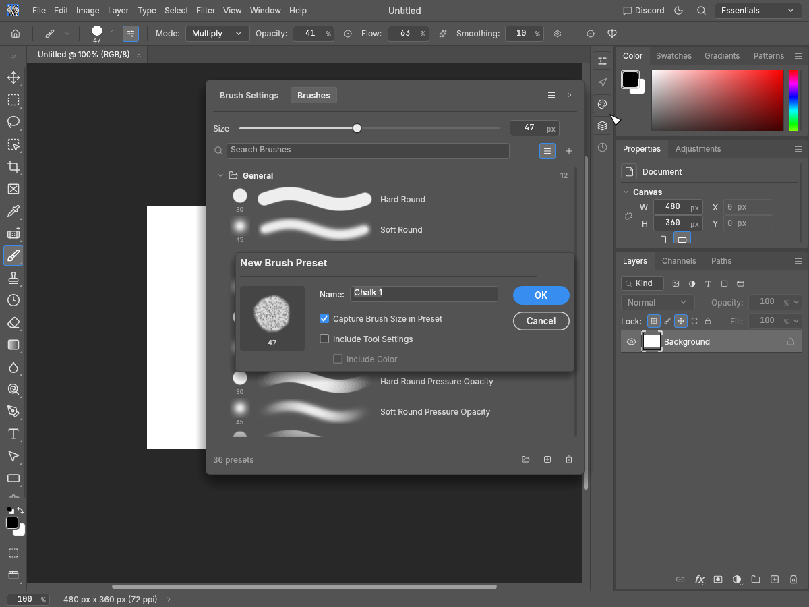

# Brush Settings menu preset-confirmation evidence

[#3477](https://github.com/storytold/photocraft/issues/3477), New Brush Preset panel-menu entry only. Follow-up to the existing shared dialog from #4490 / #4563. The plus buttons and picker gear menu already use that dialog; the Settings hamburger action still used the immediate-save/inline-rename path.

Before: production source at main 99e1138877e6aa7e856c6883b415e708d042fc59. After: tested source 613e12b8c99ee420514a9892cfee689eb4a84d4f. Both phases use the same original evidence driver and real full-app widgets. Eight native offscreen screenshots inspected; no Photoshop installation, asset or pixel oracle was used.

## Reproduction and observed state

Fresh Session, English, manual saved theme selection (both Ui theme and actual Tokens palette are checked), white 480×360 document. Select the project’s built-in Chalk brush and set size=47, opacity=.41, flow=.63, mode=Multiply. Open Brush Settings on tab 0 or 1, click its actual hamburger and New Brush Preset… menu item.

Before, all four cases go from 36 to 37 presets, append one save command, select Brush 1 and open no dialog. On the Brushes tab the already-saved item enters inline rename. After, all four cases retain 36 presets, the same brush and Chalk selection, append no command and open one shared dialog with Chalk 1, Capture Size on, Tool Settings/Color off. Name and capture choices can be reviewed before OK; Cancel/Escape saves nothing.

Cases: Pro Medium at 1200×900/1× on each tab; Pro Light at 1200×900/1×; Pro Medium at 900×720/2×. before-state.json and after-state.json contain the actual preset counts, names, command deltas and dialog fields.

## Tests

Three new regression tests; two existing tests extended/corrected. At the baseline, the three new tests and the added fifth entry point in the existing dialog test fail because no dialog opens; the amended panel-menu test catches the premature library write (37 versus 36). Three existing dialog guards pass. Final tests cover both tabs in all 14 explicitly applied themes, actual Cancel/Escape without library/brush/current-preset/history changes, typed name and capture choices, exactly one save on OK, source preservation, size/tool-option behavior when selecting the saved preset, name focus/Enter, duplicate protection and fresh reopening. All final tests pass.

Full touched UI package with HEIF, examples and doctests: 2,792 passed, zero failed, 12 ignored. Strict all-target Clippy, fmt, layers and wasm passed. This changes UI event routing into the existing dialog and command; no paint/render loop, engine command, format or preset model changed.

Validation:

    cargo test --locked -p photocraft-ui-egui --features photocraft-io/heif --no-fail-fast
    cargo clippy --locked -p photocraft-ui-egui --features photocraft-io/heif --all-targets -- -D warnings
    cargo fmt --all -- --check
    cargo xtask layers
    cargo xtask wasm

## Reproduce the captures

Use a separate source checkout at the exact revision. Copy preset_menu_evidence.rs into crates/ui-egui/examples/. Build it with cargo build --locked -p photocraft-ui-egui --features photocraft-io/heif --example preset_menu_evidence, then run target/debug/examples/preset_menu_evidence before/after /path/to/pngs /path/to/state.json. The driver queries and clicks real accessible widgets, checks the saved appearance and palette, and rejects state that does not reproduce the expected immediate/deferred creation. Remove the temporary example after capturing.

Original driver: MIT OR Apache-2.0 (licenses included). Screenshots show PhotoCraft and its own generated built-in brush on a synthetic blank document; existing branding/assets retain their project terms.

| Before | After |
| --- | --- |
|  |  |
|  |  |
