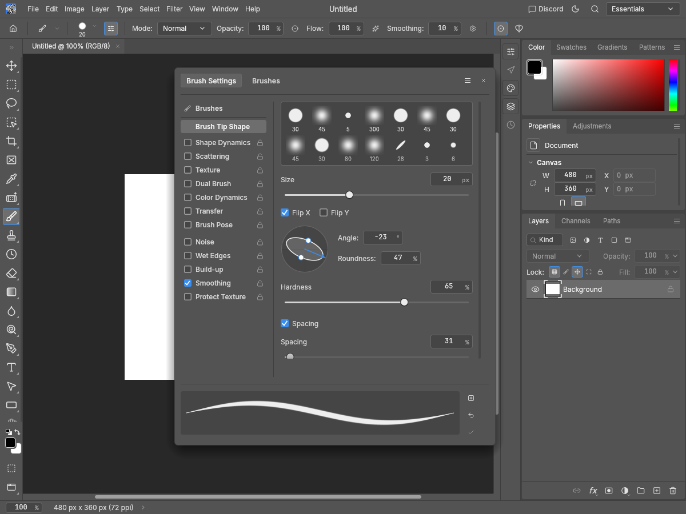
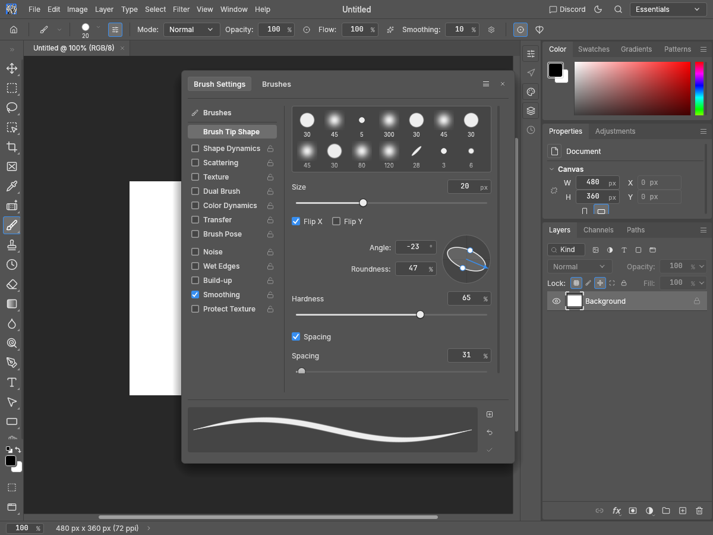

# Brush Tip Shape Angle/Roundness layout evidence

Addresses only the Angle/Roundness layout subsection of https://github.com/storytold/photocraft/issues/3825.

Before source: clean main `99e1138877e6aa7e856c6883b415e708d042fc59`. After source: `17f8f80b8ca04ded8277685a27f2455074ae7bad`. All twelve native egui snapshot images were inspected (Apple M4 / Metal). Synthetic white 480×360 document, English UI. Round fixture: 0°, 100% roundness. Shaped fixture: −23°, stored roundness 0.473 (shown as 47%). Hardness 65%, spacing 31%, Flip X on in both. Pro Medium and Pro Light at 1200×900, plus Pro Medium at 900×720 with 2× display scale. Identical settings in both phases.

| Before | After |
| --- | --- |
|  |  |

Capture names identify phase, theme/scale and geometry. Images and script live on a separate fork branch and are outside the code PR.

## Verification

Four new egui tests. The layout regression fails before the fix and passes afterward across all 14 themes at 280 and 340 logical pixels: numeric controls left of the ellipse, aligned input columns and right-aligned labels, no implicit rounding. Three behavior guards pass before and after: degree/percentage edits and limits, real arrow and staged roundness-handle drags, unrelated-value retention and exact `tools.setBrush` journal routing with one command per gesture.

Full UI package with HEIF, including examples and doctests: 2,793 passed, zero failed, 12 ignored. Strict all-target Clippy, fmt, layers and wasm passed.

```sh
cargo test --locked -p photocraft-ui-egui --features photocraft-io/heif --no-fail-fast
cargo clippy --locked -p photocraft-ui-egui --features photocraft-io/heif --all-targets -- -D warnings
cargo fmt --all -- --check
cargo xtask layers
cargo xtask wasm
cargo build --locked -p photocraft-ui-egui --features photocraft-io/heif --example snapshot
python3 capture.py --repo /path/to/photocraft --out /path/to/captures --phase after
```

For before captures, build the exact before revision and use `--phase before`.
