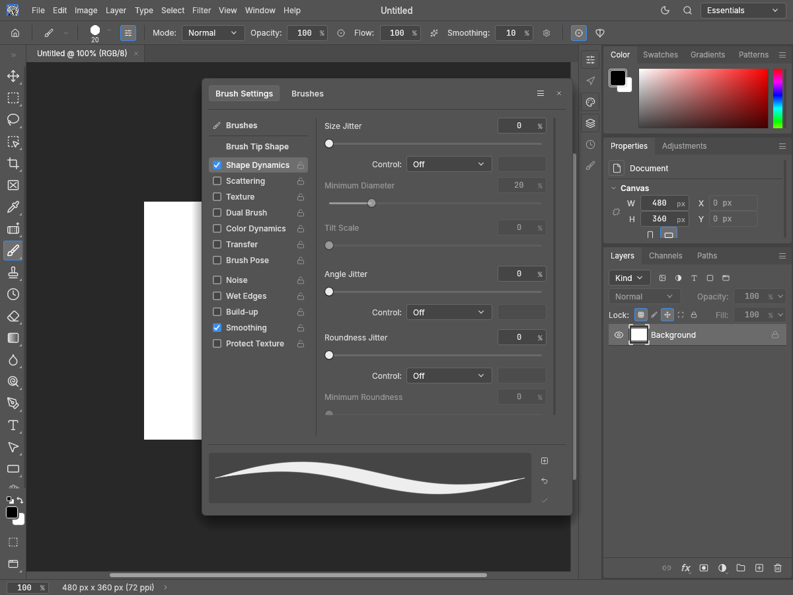
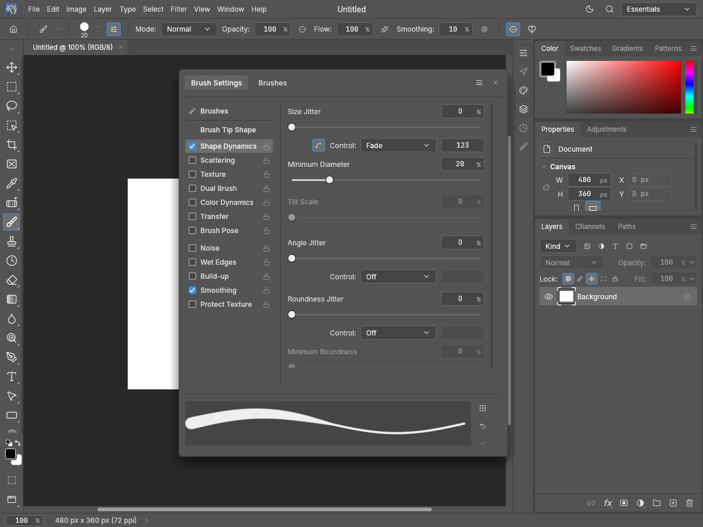
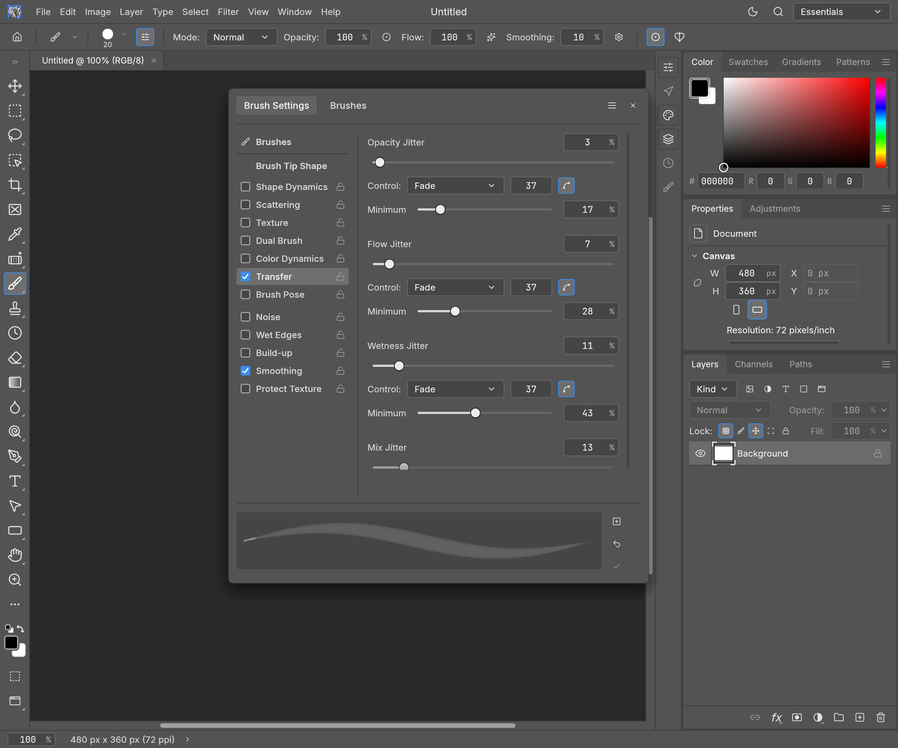
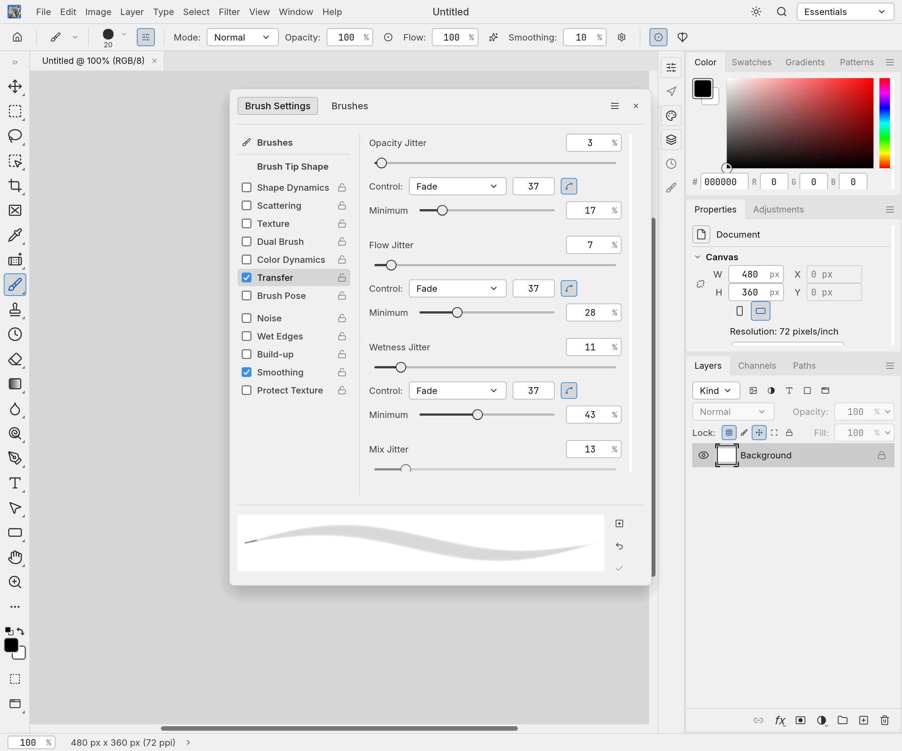

# PhotoCraft #4829: Fade and response curves after main integration

Tested source: `891ddc5b8d10d026ca8c23f262dfb26da80946f3`. Upstream main: `2a952f164c0b4cf936b1c6497db10dd095341c00`.

The merge keeps the inactive Fade field, its 74-point numeric width and saved count, together with upstream's per-dynamic response-curve button and editor. The curve toggle sits to the left of the Control label so the existing controller and Fade field keep their alignment.

Five native egui/wgpu captures on Apple M4 / Metal: synthetic 480×360 document, English interface, Pro Medium and Pro Light, with a 2× scale case. Fade count 123; a non-linear Size curve is set in the pressure/Fade fixtures. The captures show the button state; editor opening and curve editing are checked by the real-window egui regression in all 14 themes. No physical-tablet or Photoshop pixel-equivalence claim.

| Off | Fade and configured curve |
| --- | --- |
|  |  |

[Pressure](oct16-4829-pressure-curve.png) · [Light](oct16-4829-light.png) · [2× scale](oct16-4829-scale2.png)

Reproduction: check out the exact source above, build the native snapshot example, then run `python3 capture.py --repo /path/to/photocraft --out /path/to/captures`. The driver contains the exact brush/UI fixtures. These captures are after-integration evidence; the PR's earlier before/after captures retain their original historical revisions.

## #5278: Transfer Minimum alongside upstream response curves

Tested source: `ea256818bd4e5d81def74977c5f26e718921e953`. Same upstream main as above.

At a 280-point section width, the new Fade curve toggle previously widened Control by 12.8 points and shifted Minimum's numeric column. The Fade dropdown now uses at most the remaining width. Both upstream curve controls and the saved count remain. The existing regression checks the compact track, numeric column, disabled state and fractional model values, and additionally checks curve visibility and nonoverlap with the Fade count in all 14 themes at 280 and 340 points with Off/Fade/Pen Pressure.

These two native full-panel captures show the integrated Transfer controls at their normal window width in Pro Medium and Pro Light; narrow-section geometry is asserted by the regression rather than claimed from these wider captures. Curve opening/editing remains covered by the upstream integration test.

Reproduce these two captures from the #5278 source above with `python3 capture-transfer.py --repo /path/to/photocraft --out /path/to/captures`.
