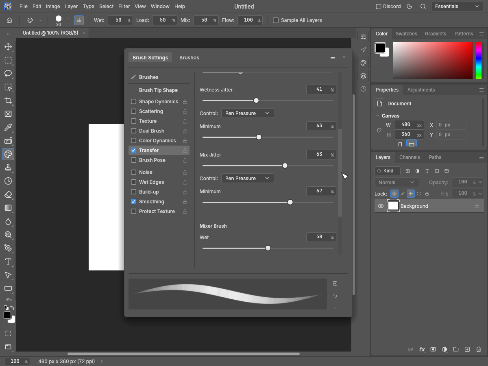

# Transfer Wetness/Mix availability evidence

Addresses the Wetness/Mix tool-applicability subsection of https://github.com/storytold/photocraft/issues/3825.

Before source: clean main `99e1138877e6aa7e856c6883b415e708d042fc59`. After source: `69cd2abafc10a60a563060461355db5641b5bf27`. All twelve images were generated with the native egui snapshot example, Apple M4 / Metal, and inspected. Synthetic white 480×360 document, English UI, no personal artwork. Pro Medium and Pro Light at 1200×900, plus Pro Medium at 900×720 with 2× display scale. The script clicks the scrollbar to show both Transfer blocks.

| Normal Brush before | Normal Brush after | Mixer Brush after |
| --- | --- | --- |
|  |  |  |

The screenshot names identify phase, theme/scale and tool. Values are deliberately identical across fixtures: Wetness Jitter 41%, minimum 43%; Mix Jitter 63%, minimum 67%. The separate legacy Mixer Brush options below these blocks are outside this change's scope.

## Verification

Three new regression tests fail before the availability fix and pass after it. They cover all 14 themes and 67 tool contexts; controller, Fade-step and minimum availability; disabled keyboard, field and slider drags; active edits; real Brush/Mixer Brush cache swaps and `tools.setBrush` journal routing. Existing minimum-field regressions continue to cover Control Off.

Full UI package with HEIF, including example compilation and doctests: 2,792 passed, zero failed, 12 ignored. Strict UI all-target Clippy, fmt, layer and wasm checks passed.

```sh
cargo test --locked -p photocraft-ui-egui --features photocraft-io/heif --no-fail-fast
cargo clippy --locked -p photocraft-ui-egui --features photocraft-io/heif --all-targets -- -D warnings
cargo fmt --all -- --check
cargo xtask layers
cargo xtask wasm
cargo build --locked -p photocraft-ui-egui --features photocraft-io/heif --example snapshot
python3 capture.py --repo /path/to/photocraft --out /path/to/captures --phase after
```

For before captures, build the exact before revision and use `--phase before`. `capture.py` contains the precise fixtures for both phases. The images and capture script live on an independent fork branch and are not part of the code PR.
